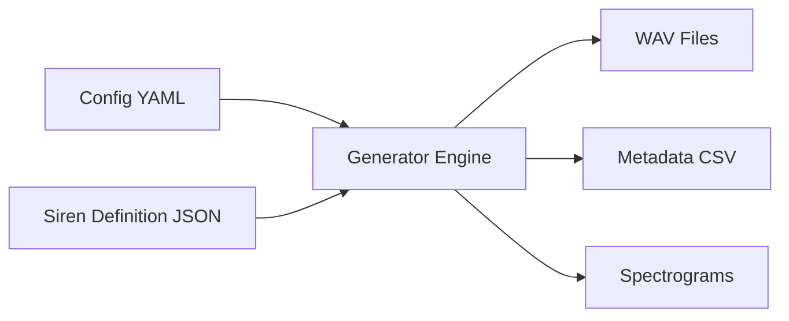

# DASSS - Dry Anechoic Synthetic Siren Sounds

**DASSS** is a Python-based tool designed to generate **synthetic siren audio samples** in a dry, anechoic format. It produces physically modeled, realistic emergency vehicle siren sounds suitable for machine learning, acoustic research, and simulation environments.

---

## 🚀 Key Features

*   **Multi-Standard Support**: Ready-to-use definitions for USA (SAE J1849), Europe (DIN 14610, NF S32-001), UK, and more.
*   **Physical Modeling**: Simulates Electronic, Mechanical, and Pneumatic sirens with distinct characteristics like motor spin-up/down.
*   **Realism Processing**: Includes analog saturation, horn frequency response filtering, and oscillator voltage drift ("jitter").
*   **Batch Generation**: Generate large datasets with randomized parameters for ML training.
*   **Spectrogram Export**: Automatically generates visual spectrograms for every audio file.
*   **GPU Acceleration**: Optional Support for Apple Metal (MPS) acceleration on macOS.

---

## 🛠️ Installation

1.  **Clone the repository**:
    ```bash
    git clone https://github.com/yourusername/DASSS.git
    cd DASSS
    ```

2.  **Install dependencies**:
    ```bash
    pip install -r requirements.txt
    ```

    *Note: For GPU acceleration on macOS, ensure you have a compatible version of PyTorch installed.*

---

## ⚡ Quick Start

Generate a batch of siren sounds using the included example configuration:

```bash
python main.py configs/batch_example.yaml
```

This will create an `output/` directory containing:
*   Generated `.wav` files (24-bit PCM)
*   `metadata.csv` with generation parameters
*   `spectrograms/` folder with PNG visualizations

---

## ⚙️ Configuration

DASSS is driven by two main configuration files:

1.  **Batch Configuration (`.yaml`)**: Controls the generation session (number of samples, duration, audio quality, realism effects).
2.  **Siren Definition (`.json`)**: Defines the acoustic properties of the siren (frequency ranges, sweep patterns, waveforms).

### Example Batch Config (`configs/batch_example.yaml`)

```yaml
definition_file: "configs/def_sae_j1849.json"
output_dir: "output/batch_01"
num_iterations: 5
duration_s: 10.0
sample_rate: 44100
realism:
  analog_saturation: true
  horn_filter: true
  oscillator_jitter: true
```

For full documentation on all parameters, see [docs/DASSS_Documentation.md](docs/DASSS_Documentation.md).

---

## 🧩 Architecture

DASSS separates the **generation logic** from the **siren definitions**, allowing for infinite variations of standard sirens.



---

## 📚 Documentation

Detailed documentation is available in the `docs/` directory:

*   [**Comprehensive Documentation**](docs/DASSS_Documentation.md): Complete guide to architecture, schemas, and usage.
*   [**Siren Standards**](docs/Siren%20Standards%20and%20Manufacturer%20Specifications.md): Reference for international siren standards implemented in DASSS.

---

## 🤝 Contributing & Authentication

To contribute to this repository (fork, clone over HTTPS, or push changes), GitHub requires authentication via a **Personal Access Token (PAT)**.

### Creating a Personal Access Token

1. Sign in to [github.com](https://github.com) and click your profile picture → **Settings**.
2. In the left sidebar, click **Developer settings** → **Personal access tokens** → **Tokens (classic)**.
3. Click **Generate new token (classic)**.
4. Give the token a descriptive **Note** (e.g., `DASSS dev`).
5. Set an **Expiration** date (e.g., 90 days).
6. Under **Select scopes**, check at least:
   - `repo` – full access to public/private repositories
7. Click **Generate token** and **copy it immediately** (you won't be able to see it again).

### Using Your Token

When Git prompts for a password (e.g., during `git clone` or `git push`), paste your PAT instead of your GitHub account password:

```bash
git clone https://github.com/marco-giordano/DASSS.git
# Username: your-github-username
# Password: <paste your PAT here>
```

To avoid re-entering it every time, cache it with Git's credential helper:

```bash
# macOS – store in Keychain (secure)
git config --global credential.helper osxkeychain

# Windows – Git Credential Manager (installed with Git for Windows)
git config --global credential.helper manager

# Linux – cache in memory for 1 hour (no disk storage)
git config --global credential.helper 'cache --timeout=3600'
```

> **Security note**: treat your PAT like a password. Never commit it to source control or share it publicly.

---

## 📄 License

[MIT License](LICENSE) (or correct license if applicable)
