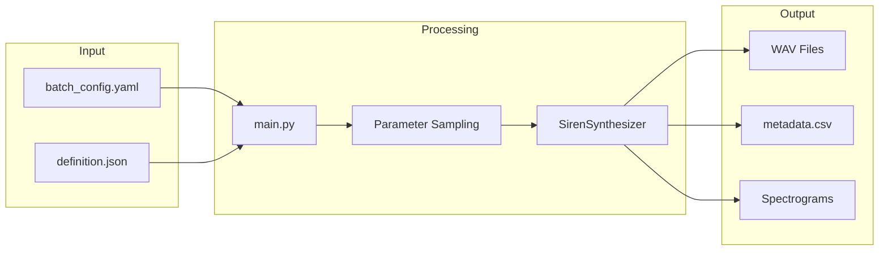
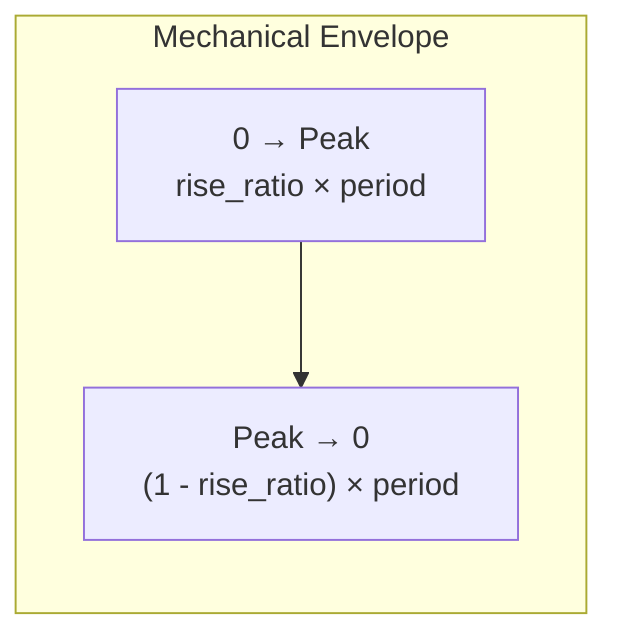

# DASSS - Dry Anechoic Synthetic Siren Sounds

> **Comprehensive Documentation**  
> Version 1.0 | January 2026

---

## Table of Contents

1. [Project Scope](#project-scope)
2. [Architecture Overview](#architecture-overview)
3. [YAML Batch Configuration Reference](#yaml-batch-configuration-reference)
4. [JSON Siren Definition Schema](#json-siren-definition-schema)
5. [Siren Modes Reference](#siren-modes-reference)
6. [Waveform Types](#waveform-types)
7. [Realism Features](#realism-features)
8. [Usage Examples](#usage-examples)

---

## Project Scope

**DASSS** (Dry Anechoic Synthetic Siren Sounds) is a Python-based tool for generating **synthetic siren audio samples** in a dry, anechoic format. The project is designed to produce realistic emergency vehicle siren sounds that can be used for:

- **Machine Learning Datasets** – Creating training data for emergency sound detection systems
- **Acoustic Research** – Studying siren characteristics across different international standards
- **Simulation Environments** – Providing realistic audio for driving simulators or virtual environments
- **Audio Production** – Generating reference siren sounds for sound design

### Key Features

| Feature | Description |
|---------|-------------|
| **Multi-Standard Support** | Supports siren definitions from USA (SAE J1849), Europe (DIN 14610, NF S32-001), UK, Italy, Australia, Japan, China, and more |
| **Multiple Siren Modes** | Wail, Yelp, Hi-Lo, Two-Tone, Phaser, Piercer, and Rumbler |
| **Physical Modeling** | Electronic, Mechanical, and Pneumatic siren types with distinct characteristics |
| **Realism Processing** | Analog saturation, horn filtering, oscillator jitter, and mechanical asymmetry |
| **Batch Generation** | Generate multiple samples per siren mode with randomized parameters |
| **Metal/GPU Acceleration** | Optional PyTorch Metal (MPS) acceleration for macOS |
| **Spectrogram Export** | Automatic visualization generation for each audio file |

### Technical Stack

- **Python 3.x** with type hints and Pydantic validation
- **NumPy/SciPy** for signal processing
- **PyTorch** (optional) for GPU acceleration
- **SoundFile** for audio I/O
- **Matplotlib** for spectrogram generation

---

## Architecture Overview



### Core Modules

| Module | Purpose |
|--------|---------|
| `main.py` | Entry point – loads configs, orchestrates generation loop |
| `src/generator.py` | `SirenSynthesizer` class – core audio synthesis engine |
| `src/schemas.py` | Pydantic models for configuration validation |
| `src/utils.py` | Parameter sampling, file I/O, spectrogram utilities |

---

## YAML Batch Configuration Reference

The **batch configuration file** (`.yaml`) controls the generation session. All parameters except `definition_file` have sensible defaults.

### Complete Parameter Reference

```yaml
# === REQUIRED ===
definition_file: "configs/def_sae_j1849.json"  # Path to siren definition JSON

# === OUTPUT SETTINGS ===
output_dir: "output/batch_01"     # Directory for generated files
sample_rate: 44100                # Sampling rate in Hz (default: 44100)
bit_depth: 24                     # Bit depth: 16, 24, or 32 (default: 24)

# === GENERATION SETTINGS ===
num_iterations: 5                 # Samples per siren mode (default: 1)
duration_s: 10.0                  # Duration in seconds (default: 10.0)
seed: 42                          # Random seed for reproducibility (optional)

# === PROCESSING SETTINGS ===
oversampling: 2                   # Anti-aliasing factor, 1=off (default: 8)
use_metal: true                   # Metal/GPU acceleration (default: false)

# === SIREN-SPECIFIC ===
enforce_complete_cycle: true      # End on complete cycle (default: true)
min_frequency_separation: 1.5     # Min f2/f1 ratio for sampling (default: 1.2)

# === OUTPUT OPTIONS ===
generate_spectrograms: true       # Generate PNG spectrograms (default: false)

# === REALISM SETTINGS ===
realism:
  analog_saturation: true         # Soft-clipping saturation (default: true)
  horn_filter: true               # Speaker response simulation (default: true)
  oscillator_jitter: true         # Voltage drift simulation (default: true)
  mechanical_asymmetry: true      # Asymmetric envelope (default: true)
  jitter_amount: 0.08             # Jitter intensity 0.0-1.0 (default: 0.01)
```

### Parameter Details

#### Output Settings

| Parameter | Type | Default | Description |
|-----------|------|---------|-------------|
| `output_dir` | string | `"./output"` | Directory where generated audio files, metadata, and spectrograms are saved |
| `sample_rate` | integer | `44100` | Audio sampling rate in Hz. Common values: 22050, 44100, 48000, 96000 |
| `bit_depth` | integer | `24` | PCM bit depth for WAV export. Values: 16, 24, 32 |

#### Generation Settings

| Parameter | Type | Default | Description |
|-----------|------|---------|-------------|
| `num_iterations` | integer | `1` | Number of audio samples generated **per siren mode** defined in the JSON |
| `duration_s` | float | `10.0` | Target duration for each audio file in seconds |
| `seed` | integer | *None* | Random seed for reproducible parameter sampling |

#### Processing Settings

| Parameter | Type | Default | Description |
|-----------|------|---------|-------------|
| `oversampling` | integer | `8` | Internal processing at N× sample rate, then decimated. Higher = better anti-aliasing but slower. Set to 1 to disable |
| `use_metal` | boolean | `false` | Enable PyTorch Metal (MPS) acceleration on Apple Silicon. Requires PyTorch installation |

#### Siren-Specific Settings

| Parameter | Type | Default | Description |
|-----------|------|---------|-------------|
| `enforce_complete_cycle` | boolean | `true` | When true, extends audio to end on a complete waveform cycle (prevents clicks) |
| `min_frequency_separation` | float | `1.2` | Minimum ratio between f_max and f_min when randomly sampling frequency ranges. Ensures perceptible frequency variation |

#### Realism Settings

| Parameter | Type | Default | Description |
|-----------|------|---------|-------------|
| `analog_saturation` | boolean | `true` | Apply soft-clipping (tanh) saturation for analog warmth |
| `horn_filter` | boolean | `true` | Simulate speaker/horn frequency response with bandpass filtering |
| `oscillator_jitter` | boolean | `true` | Add low-frequency noise to simulate electronic oscillator drift |
| `mechanical_asymmetry` | boolean | `true` | Enable asymmetric rise/fall envelope for mechanical siren types |
| `jitter_amount` | float | `0.01` | Intensity of oscillator jitter (0.0 = none, 1.0 = maximum) |

---

## JSON Siren Definition Schema

The **siren definition file** (`.json`) describes the acoustic characteristics of sirens from a specific standard or region.

### Top-Level Structure

```json
{
    "standard": "SAE J1849 / CA Title 13",
    "region": "USA",
    "seed": 42,
    "modes": {
        "mode_name_1": { ... },
        "mode_name_2": { ... }
    }
}
```

### Top-Level Fields

| Field | Type | Required | Description |
|-------|------|----------|-------------|
| `standard` | string | ✅ Yes | Name of the siren standard (e.g., "SAE J1849", "DIN 14610") or "User-Defined" |
| `region` | string | ❌ No | Country or region of adoption (e.g., "USA", "Germany", "Global") |
| `seed` | integer | ❌ No | Random seed for parameter sampling (overrides batch config if set) |
| `modes` | object | ✅ Yes | Dictionary of siren mode definitions (key = mode name) |

---

### Mode Definition Schema

Each mode in the `modes` object follows this structure:

```json
{
    "type": "electronic",
    "mode": "wail",
    "description": "Standard electronic wail siren",
    "frequency_range": {
        "min": 600.0,
        "max": 1600.0
    },
    "period_range": {
        "min": 3.0,
        "max": 5.0
    },
    "waveform": "square",
    "duty_cycle": 0.5,
    "mechanical_profile": { ... },
    "variable_wail": { ... },
    "tone_pattern": "hhhlll"
}
```

### Mode Fields Reference

#### Core Fields

| Field | Type | Required | Description |
|-------|------|----------|-------------|
| `type` | enum | ✅ Yes | Siren generation type: `"electronic"`, `"mechanical"`, or `"pneumatic"` |
| `mode` | enum | ✅ Yes | Siren mode category (see [Siren Modes](#siren-modes-reference)) |
| `description` | string | ❌ No | Human-readable description of this siren configuration |

#### Frequency Configuration

> [!IMPORTANT]
> Each mode **must** define either `frequency_range` OR `nominal_frequencies`, but not both.

| Field | Type | Required | Description |
|-------|------|----------|-------------|
| `frequency_range` | object | ⚠️ Conditional | Random sampling range for frequency sweep. Contains `min` and `max` in Hz |
| `nominal_frequencies` | object | ⚠️ Conditional | Fixed frequencies (no randomization). Contains `min` (low tone) and `max` (high tone) in Hz |

**`frequency_range`** – Used when frequencies should be randomly sampled within bounds:
```json
"frequency_range": {
    "min": 600.0,   // Lower bound of sampling range (Hz)
    "max": 1600.0   // Upper bound of sampling range (Hz)
}
```

**`nominal_frequencies`** – Used for standards that define exact fixed frequencies:
```json
"nominal_frequencies": {
    "min": 466.0,   // Low tone frequency (Hz)
    "max": 622.0    // High tone frequency (Hz)
}
```

#### Period Configuration

| Field | Type | Required | Description |
|-------|------|----------|-------------|
| `period_range` | object | ✅ Yes | Range for modulation period in seconds. Contains `min` and `max` |

```json
"period_range": {
    "min": 3.0,   // Minimum period in seconds
    "max": 5.0    // Maximum period in seconds
}
```

#### Waveform Configuration

| Field | Type | Default | Description |
|-------|------|---------|-------------|
| `waveform` | enum | `"square"` | Base waveform type (see [Waveform Types](#waveform-types)) |
| `duty_cycle` | float | `0.5` | Duty cycle for square/trapezoid waves (0.0 to 1.0) |

#### Advanced Options

| Field | Type | Default | Description |
|-------|------|---------|-------------|
| `mechanical_profile` | object | *None* | Custom envelope for mechanical/pneumatic sirens |
| `variable_wail` | object | *None* | Enable non-periodic pitch variation |
| `tone_pattern` | string | *None* | Custom hi/lo pattern for two-tone modes |

---

### Mechanical Profile Schema

Controls the asymmetric envelope for mechanical and pneumatic siren types:

```json
"mechanical_profile": {
    "rise_ratio": 0.2,
    "rise_exponent": 0.5,
    "fall_exponent": 2.0
}
```

| Field | Type | Default | Description |
|-------|------|---------|-------------|
| `rise_ratio` | float | `0.2` | Fraction of period for rise phase (0.0 to 1.0). E.g., 0.2 = 20% rise, 80% fall |
| `rise_exponent` | float | `0.5` | Curvature of rise phase. <1 = fast start (concave), >1 = slow start (convex) |
| `fall_exponent` | float | `2.0` | Curvature of fall phase. <1 = fast coast, >1 = slow coast (realistic motor spin-down) |



---

### Variable Wail Schema

Enables non-periodic pitch variation for realistic mechanical siren behavior:

```json
"variable_wail": {
    "enabled": true,
    "variation_magnitude": 0.2
}
```

| Field | Type | Default | Description |
|-------|------|---------|-------------|
| `enabled` | boolean | `true` | Enable variable wail processing |
| `variation_magnitude` | float | `0.2` | Amount of cycle-to-cycle variation (0.0 to 1.0). Higher = more randomness in peak frequency |

---

### Tone Pattern Schema

For `hi-lo` and `two-tone` modes, defines custom alternation patterns:

```json
"tone_pattern": "hhhlll"
```

| Value | Description |
|-------|-------------|
| `h` | High frequency tone |
| `l` | Low frequency tone |

The pattern repeats for the duration of the audio. Examples:
- `"hl"` – Standard alternating hi-lo (default)
- `"hhhlll"` – Three high, three low (Martin Horn pattern)
- `"hlhlll"` – Various emergency vehicle patterns

---

## Siren Modes Reference

| Mode | Enum Value | Description | Typical Period |
|------|------------|-------------|----------------|
| **Wail** | `wail` | Slow, sweeping frequency rise and fall | 3–8 seconds |
| **Yelp** | `yelp` | Fast, aggressive frequency modulation | 0.3–0.5 seconds |
| **Hi-Lo** | `hi-lo` | Alternating between two fixed tones | 0.8–1.2 seconds |
| **Two-Tone** | `two-tone` | European-style alternating tones with custom patterns | 1–2 seconds |
| **Phaser** | `phaser` | Very fast modulation creating phasing effect | 0.1–0.2 seconds |
| **Piercer** | `piercer` | Ultra-fast modulation for maximum attention | 0.05–0.08 seconds |
| **Rumbler** | `rumbler` | Low-frequency "rumble" for intersection clearing | 4–6 seconds |

---

## Waveform Types

| Waveform | Enum Value | Characteristics |
|----------|------------|-----------------|
| **Sine** | `sine` | Pure tone, no harmonics. Smooth sound |
| **Square** | `square` | Rich in odd harmonics. Classic electronic siren sound |
| **Sawtooth** | `sawtooth` | All harmonics. Bright, buzzy tone. Typical for mechanical sirens |
| **Triangle** | `triangle` | Odd harmonics only, softer than square. Mellow tone |
| **Trapezoid** | `trapezoid` | Modified square with sloped edges. Smoother transitions |

---

## Realism Features

DASSS includes several signal processing stages to simulate real-world siren characteristics:

### Analog Saturation
Applies soft-clipping via `tanh()` function to simulate amplifier saturation. Creates harmonic distortion and "warmth."

### Horn Filter
Bandpass filtering that simulates the frequency response of physical siren horns/speakers, attenuating extreme low and high frequencies.

### Oscillator Jitter
Adds low-frequency noise to the base frequency to simulate electronic oscillator instability and voltage drift.

### Mechanical Asymmetry
For mechanical siren types, applies an asymmetric envelope where:
- **Rise phase** is fast (motor spinning up)
- **Fall phase** is slow (motor spinning down due to inertia)

---

## Usage Examples

### Basic Generation

```bash
python main.py configs/batch_example.yaml
```

### Generated Output Structure

```
output/batch_01/
├── SAE_J1849_wail_generic_00.wav
├── SAE_J1849_wail_generic_01.wav
├── SAE_J1849_yelp_generic_00.wav
├── metadata.csv
├── batch_example.yaml (backup)
├── def_sae_j1849.json (backup)
└── spectrograms/
    ├── SAE_J1849_wail_generic_00.wav.png
    └── ...
```

### Creating Custom Definitions

1. Copy `configs/template_definition.json`
2. Modify `standard` and `region`
3. Add modes matching your requirements
4. Reference in a batch YAML config

---

## Included Siren Definitions

| File | Standard | Region |
|------|----------|--------|
| `def_sae_j1849.json` | SAE J1849 / CA Title 13 | USA |
| `def_italy_cds.json` | Codice della Strada Art. 177 | Italy |
| `def_germany_din14610.json` | DIN 14610 | Germany |
| `def_france_nfs32001.json` | NF S32-001 | France |
| `def_uk_home_office.json` | Home Office Guidelines | UK |
| `def_australia_adr.json` | ADR 25 | Australia |
| `def_japan_road_traffic.json` | Road Traffic Act | Japan |
| `def_china_gb8108.json` | GB 8108 | China |
| `def_netherlands_prio1.json` | PRIO-1 System | Netherlands |
| `def_comprehensive_example.json` | Feature Demo | Global |
| `template_definition.json` | Template | — |

---

*Generated by DASSS Documentation System*
